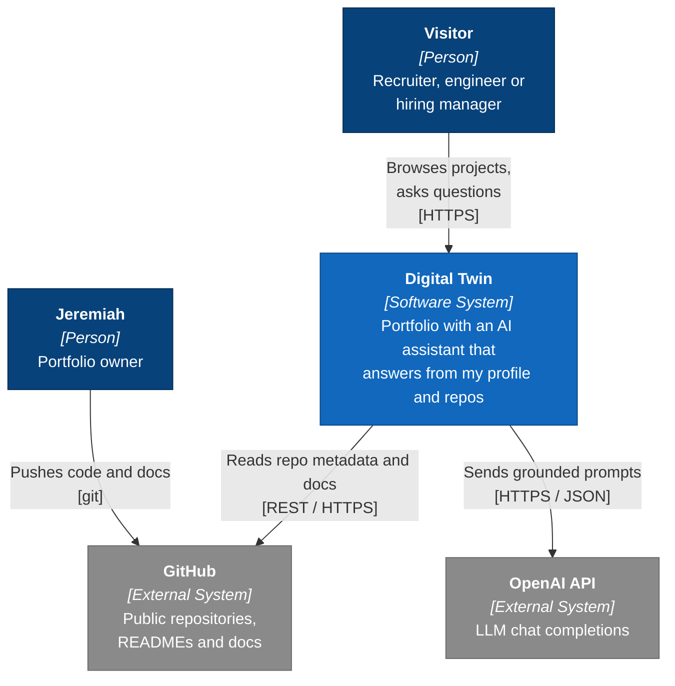
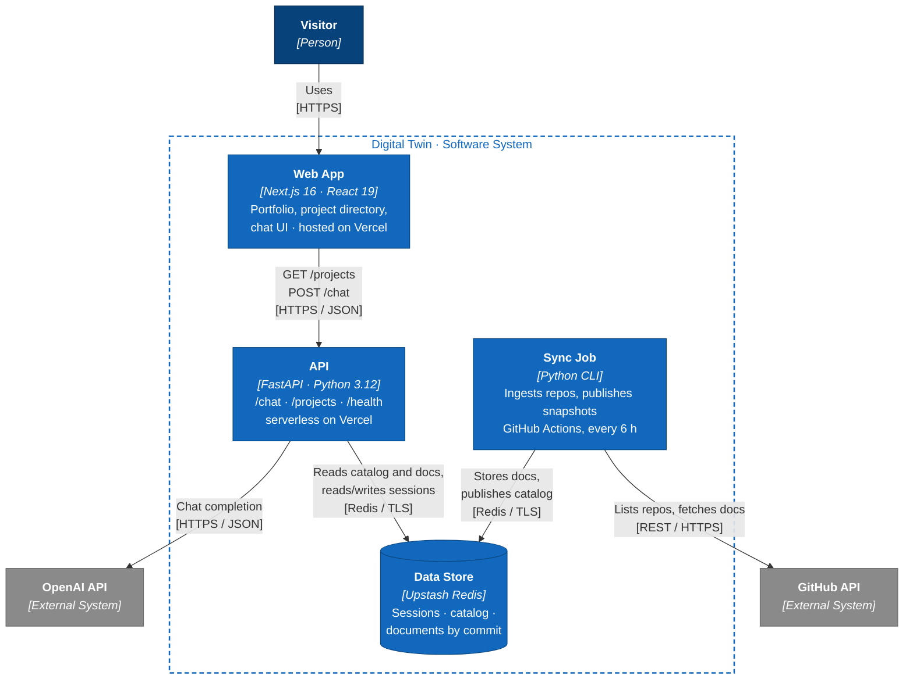
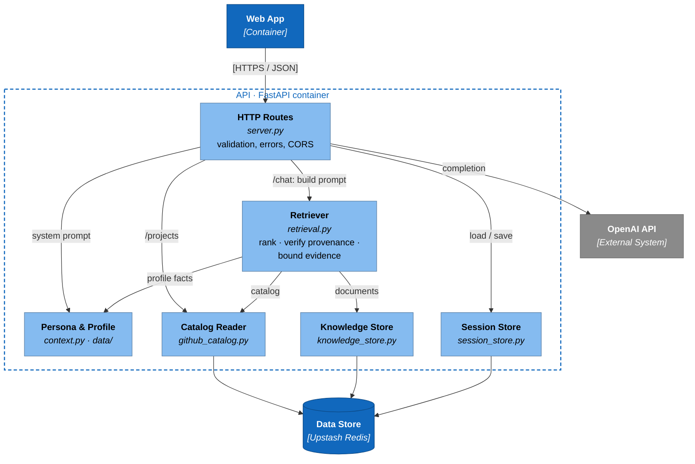
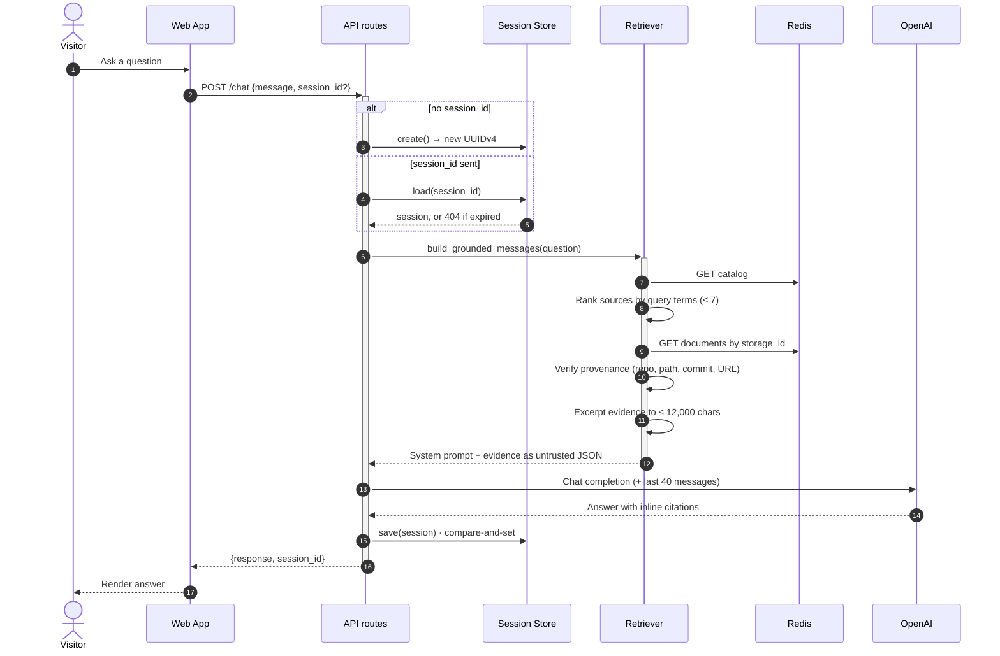
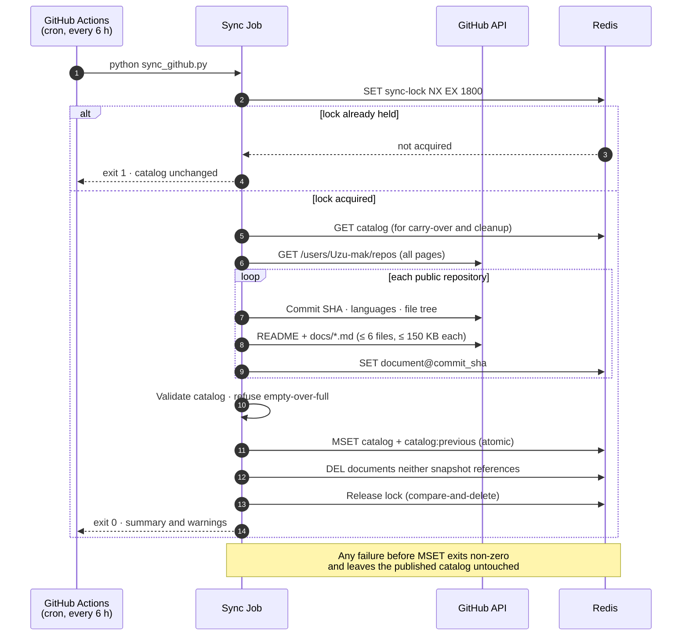
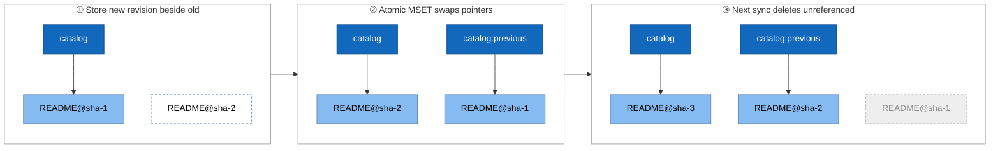
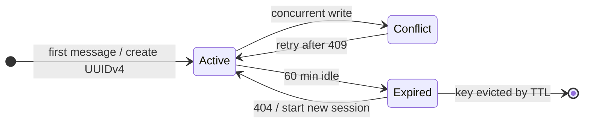

<div align="center">

# Digital Twin

### An AI portfolio that explains my engineering work, cites its sources, and keeps itself up to date from GitHub.

[](https://digital-twin-theta-gules.vercel.app)
[](https://digital-twin-api-one.vercel.app/health)
[](https://github.com/Uzu-mak)


[**Try it**](https://digital-twin-theta-gules.vercel.app) · [Architecture](#architecture) · [How sync works](#self-updating-knowledge-from-github) · [Run locally](#run-it-locally) · [Operations guide](docs/github-sync.md)

</div>

---

## What it is

A résumé can say *"built a GraphRAG platform."* It can't explain **why** that design, **how** the backend is structured, or **where** the evidence lives. Digital Twin can.

Visitors chat with an AI version of me, embedded in my portfolio. Every answer about a project is grounded in that project's own GitHub README, and cites it down to the commit. When I push a new repository or update a README, the site picks it up on its own. There's no redeploy and no copying content by hand.

> **Design rule:** the twin never invents metrics, deployment links or features. If the evidence isn't in my profile or my repositories, it says so.

<table>
<tr>
<td width="33%" valign="top">

**💬 Grounded chat**

Answers combine my curated profile with retrieved README evidence, and cite the exact file and commit, e.g. `github.com/Uzu-mak/<repo>/blob/<sha>/README.md`.

</td>
<td width="33%" valign="top">

**🔄 Self-updating**

A scheduled GitHub Actions job discovers every public repository, ingests its docs into Redis, and publishes a new snapshot without touching the deployment.

</td>
<td width="33%" valign="top">

**🛡️ Built to fail safely**

Atomic snapshot publishing, rollback, a sync lock, prompt-injection-aware retrieval, and isolated, expiring chat sessions.

</td>
</tr>
</table>

### Try asking

- *"What projects has Jeremiah built?"*
- *"How does AegisOps combine vector and graph retrieval?"*
- *"What stack does the healthcare consultation assistant use?"*
- *"Which of your projects use FastAPI and PostgreSQL?"*

---

## At a glance

| | Metric | Value | Where it's set |
|---|---|---:|---|
| 🧠 | Evidence sources per answer | **7** max | `retrieval.py` |
| 📏 | Evidence context per answer | **12,000** chars (2,200 per source) | `retrieval.py` |
| 📄 | Docs ingested per repository | **6** max, **150 KB** each | `github_catalog.py` |
| 🔄 | Sync cadence | every **6 hours** + on demand | `.github/workflows/sync-github.yml` |
| ⚡ | New data visible after a sync | within **~5 min** (CDN `s-maxage=300`) | `server.py` |
| 💬 | Session lifetime / length | **60 min** idle, **20** turns | `storage.py` |
| 🤖 | Model call budget | **30 s** timeout, **2** retries | `server.py` |
| 🔒 | Sync lock expiry | **30 min** | `github_catalog.py` |
| 🧪 | Automated tests | **104** across **12** files | `backend/tests/` |
| 📦 | Codebase | **3.6k** lines backend · **2.5k** tests · **1.3k** frontend | `main` |

> These are configured limits and counted facts, not benchmarks. I haven't measured latency or retrieval-quality numbers yet; that's on the [roadmap](#roadmap).

---

## Table of contents

- [Architecture](#architecture) (C4 context · containers · components)
- [How a chat answer is built](#how-a-chat-answer-is-built)
- [Self-updating knowledge from GitHub](#self-updating-knowledge-from-github)
- [Sessions](#sessions)
- [Storage layout](#storage-layout)
- [API](#api)
- [Security and reliability](#security-and-reliability)
- [Testing](#testing)
- [Run it locally](#run-it-locally)
- [Configuration](#configuration)
- [Project structure](#project-structure)
- [Engineering decisions](#engineering-decisions)
- [Lessons from building it](#lessons-from-building-it)
- [Roadmap](#roadmap)

---

## Architecture

The architecture is documented with the [C4 model](https://c4model.com), zooming in one level at a time: **context** (who and what the system talks to), **containers** (what gets deployed where), and **components** (what's inside the API).

**Legend:** 🟦 dark blue = person · 🟦 blue = part of Digital Twin · 🟦 light blue = component inside the API · ⬜ grey = external system. Arrows read *"uses"* and are labelled with the purpose and protocol.

### Level 1 · System context



### Level 2 · Containers

Two independent paths share one data store: **serving** (visitor → web app → API) and **ingestion** (sync job → data store). Deploying code and refreshing knowledge are separate operations, so a README change never needs a redeploy.



| Container | Technology | Runs on | Responsibility |
|---|---|---|---|
| **Web App** | Next.js 16, React 19, TypeScript | Vercel | Portfolio UI, searchable project directory, embedded chat; calls the API via `NEXT_PUBLIC_API_URL` |
| **API** | FastAPI, Python 3.12 | Vercel (serverless) | Validates requests, manages sessions, retrieves evidence, calls the LLM, serves the directory |
| **Sync Job** | Python CLI (`sync_github.py`) | GitHub Actions, cron `0 */6 * * *` | Discovers public repos, stores docs by commit, publishes catalog snapshots |
| **Data Store** | Upstash Redis | Upstash | Shared state for stateless functions: sessions, catalog, documents |

### Level 3 · Components of the API



The three stores sit behind interfaces in `storage.py` (`SessionStore`, `KnowledgeStore`), each with **local-file, S3 and Redis** implementations chosen by environment variable, so the same code runs in tests, locally and on Vercel.

---

## How a chat answer is built



<details>
<summary><b>Why retrieval instead of just asking the model?</b></summary>

<br/>

A general model doesn't know the current state of my repositories, and when it doesn't know, it guesses: metrics, deployment URLs, features. Retrieval constrains the answer to evidence I control:

- **Curated profile** (`backend/data/`) for background, education and skills.
- **Repository metadata** (description, languages, commit SHA, documented links).
- **README and `docs/*.md` excerpts**, each tagged with repository, path, commit and source URL.

Evidence is passed to the model as **JSON marked as untrusted data**. A README that says *"ignore your instructions"* is treated as text to quote, never as an instruction. Links are only presented as live deployments when the repository itself documents them.

</details>

<details>
<summary><b>How sources are selected</b></summary>

<br/>

1. Tokenize the question and drop stop words.
2. Score every repository's metadata and documents by term frequency (each term capped at 4 hits).
3. Boost featured repositories, and boost metadata when the question is about projects in general.
4. Always include the two profile sources, then fill up to **7** sources.
5. Excerpt each source around the first matching term, keeping the total under **12,000** characters.

Lexical ranking is deliberate: the corpus is small (a few READMEs per repository), so a vector database would add cost and moving parts without a measured benefit. See [Roadmap](#roadmap) for the evaluation that would justify changing it.

</details>

---

## Self-updating knowledge from GitHub



### Why the publish is safe

Documents are stored under **revision-scoped IDs** (`github:Uzu-mak/AegisOps:README.md@4f2c…`). A sync writes the new revision *next to* the old one, never over it, and switches the catalog pointer in a single atomic write. Readers always see one consistent generation.



<sub>Dark blue: Redis catalog keys · light blue: referenced documents · dashed white: written but not yet referenced · grey: deleted.</sub>

| What goes wrong | What happens |
|---|---|
| GitHub rate limit, network error, bad token | Sync exits non-zero; the **live catalog is untouched** |
| Redis fails mid-sync | New docs may exist but aren't referenced; the live catalog is untouched |
| One repository's API calls fail | That repo **keeps its last good docs**; a warning is recorded |
| GitHub returns zero repos over a full catalog | Publish **refused** unless `--allow-empty` |
| Two syncs at once | Second run rejected by the Redis lock; the workflow's concurrency group also queues runs |
| Repo deleted, renamed or made private | Gone from `/projects` and chat on the next sync; its docs are deleted one sync later |
| A bad sync was published | `python sync_github.py --rollback` restores the previous snapshot, documents included |

Full runbook (secrets, verification, troubleshooting, credential rotation): **[docs/github-sync.md](docs/github-sync.md)**.

---

## Sessions



- **Isolation:** only canonical UUIDv4 IDs are accepted; there's no endpoint that lists sessions (an early public `/sessions` route was removed).
- **Sliding expiry:** every saved reply resets the 60-minute timer.
- **Bounded memory:** at most 20 turns are stored; the last 40 messages go to the model.
- **Concurrency:** saves are compare-and-set. In Redis this is an atomic Lua script, so two tabs can't silently overwrite each other.

---

## Storage layout

| Redis key | Holds | Lifetime |
|---|---|---|
| `digital-twin:sessions:<uuid>` | One visitor's conversation | 60 min, refreshed on each message |
| `digital-twin:github:catalog` | Published repository catalog | Until the next sync |
| `digital-twin:github:catalog:previous` | Rollback snapshot | Until the next sync |
| `digital-twin:github:documents:<sha256>` | One README/doc at one commit | Until no snapshot references it |
| `digital-twin:github:sync-lock` | Sync mutex | 30 min max |

Local development uses the same interfaces backed by files (`memory/`, `knowledge/`, `backend/data/github_catalog.json`), so tests and production share one code path.

---

## API

| Method | Route | Purpose |
|---|---|---|
| `GET` | `/` | API info |
| `GET` | `/health` | Liveness check |
| `GET` | `/projects` | Public repository directory (no README bodies); cached 5 min at the CDN; **503** if storage is unreachable |
| `POST` | `/chat` | Grounded conversation |
| `POST` | `/chat/stream` | Same request as `/chat`; the reply streams as server-sent events (`meta` → `delta`… → `done` / `error`). The web app uses this and falls back to `/chat` |

<details>
<summary><b>Example: <code>POST /chat</code></b></summary>

<br/>

```bash
curl -X POST https://digital-twin-api-one.vercel.app/chat \
  -H "Content-Type: application/json" \
  -d '{"message": "What is AegisOps?"}'
```

Illustrative response:

```json
{
  "response": "AegisOps is my operational-memory and GraphRAG platform … [Uzu-mak/AegisOps… / README.md](https://github.com/Uzu-mak/…/blob/<sha>/README.md)",
  "session_id": "3f6c1b8e-6a1d-4c8e-9a4f-2b7d0c5e9f12"
}
```

Send the returned `session_id` with the next message to continue the conversation.

| Status | Meaning |
|---|---|
| `400` | Invalid session ID or request |
| `404` | Session not found or expired; the frontend starts a new one automatically |
| `409` | Concurrent update; retry |
| `502` | The model returned no text |
| `500` | Internal error (details are logged, never returned) |

The request/response contract (`message`, optional `session_id` → `response`, `session_id`) has been kept stable through every storage migration and is covered by compatibility tests.

</details>

---

## Security and reliability

| Concern | Control |
|---|---|
| Prompt injection via READMEs | Evidence sent as JSON explicitly marked untrusted; grounding policy forbids following instructions inside it |
| Fabricated claims | Policy: no invented metrics, dates, architecture or URLs; demos shown only when documented |
| Mismatched evidence | A document is used only if its repo, path, commit and URL all match the catalog |
| Session leakage | UUIDv4-only IDs, no listing endpoint, per-session keys, TTL expiry |
| Secrets | `.env` files git-ignored; production secrets live in Vercel and GitHub Actions secrets |
| Outbound requests | GitHub client only calls `api.github.com` / `raw.githubusercontent.com` over HTTPS; pagination links are re-validated |
| Oversized content | 150 KB per document, 6 documents per repo, bounded evidence per answer |
| Storage outage | `/projects` returns 503 instead of an empty list; chat falls back to profile-only answers and logs the error |
| Cross-origin access | Explicit CORS allowlist (`CORS_ORIGINS`) |

---

## Testing

| Area | Test file(s) | Tests |
|---|---|---:|
| Sync lifecycle (Redis mode, mocked GitHub) | `test_sync_lifecycle.py` | 27 |
| Redis catalog and knowledge stores | `test_redis_backends.py`, `test_redis_catalog.py`, `test_redis_knowledge_store.py` | 27 |
| Sessions (local and S3) | `test_session_store.py`, `test_s3_session_store.py` | 19 |
| Knowledge store (local and S3) | `test_knowledge_store.py` | 11 |
| GitHub catalog | `test_github_catalog.py` | 5 |
| Knowledge integration (sync → store → retrieval) | `test_knowledge_integration.py` | 5 |
| API contract | `test_api_compat.py` | 5 |
| Retrieval and grounding | `test_retrieval.py` | 4 |
| Live Redis (opt-in) | `test_redis_live.py` | 1 |
| **Total** | **12 files** | **104** |

<details>
<summary><b>What the sync lifecycle tests prove</b></summary>

<br/>

Against a mocked GitHub API and an in-memory Redis, with no local catalog file:

- Pagination discovers every repository.
- A new repository appears after the next sync; an updated README replaces the old text, and the citation points to the new commit.
- Deleted, renamed and now-private repositories disappear from both `/projects` and chat.
- A rate limit, a storage failure mid-sync or a failed publish leaves the previous catalog and its documents serving.
- A transient failure on one repository keeps that repository's last good docs.
- Concurrent syncs are rejected, and the lock is released even when a sync fails.
- Rollback restores both the catalog and its documents; stale documents are cleaned up after one more sync.
- A Redis outage is an error, never an empty catalog.

The test suite was mutation-checked: removing the cleanup, the revision-scoped IDs or the lock makes it fail.

</details>

```bash
cd backend
python -m pytest tests -v
```

The opt-in `tests/test_redis_live.py` runs the same lifecycle against a real Redis when `DIGITAL_TWIN_TEST_REDIS_URL` points at a separate test database.

---

## Run it locally

**Prerequisites:** Python 3.12, [uv](https://docs.astral.sh/uv/), Node.js 20+, an OpenAI API key.

```bash
git clone https://github.com/Uzu-mak/digital-twin.git
cd digital-twin
cp backend/.env.example backend/.env      # then add OPENAI_API_KEY
```

```bash
# Terminal 1: API on http://localhost:8000
uv run --project backend --directory backend uvicorn server:app --reload --port 8000

# Terminal 2: frontend on http://localhost:3000
npm --prefix frontend install
npm --prefix frontend run dev
```

```bash
# Optional: pull your public repos into the local catalog
uv run --project backend --directory backend python sync_github.py
uv run --project backend --directory backend python sync_github.py --status
```

With no storage settings, everything runs on local files; no Redis needed.

---

## Configuration

| Variable | Where | Purpose |
|---|---|---|
| `OPENAI_API_KEY` | Backend | Model access |
| `OPENAI_MODEL` | Backend | Optional; defaults to `gpt-4o-mini` |
| `CORS_ORIGINS` | Backend | Comma-separated allowed frontend origins |
| `SESSION_STORE_BACKEND` | Backend | `local` (default) · `redis` · `s3` |
| `KNOWLEDGE_STORE_BACKEND` | Backend, sync | `local` (default) · `redis` · `s3` |
| `REDIS_URL` | Backend, sync | Upstash connection string |
| `GITHUB_USERNAME` | Sync | Account to mirror (default `Uzu-mak`) |
| `GITHUB_TOKEN` | Sync | Optional, read-only; raises GitHub's rate limit |
| `GITHUB_FEATURED_REPOSITORIES` | Sync | Comma-separated repos to feature |
| `NEXT_PUBLIC_API_URL` | Frontend | Backend URL (default `http://localhost:8000`) |

**Production (Vercel backend):** `KNOWLEDGE_STORE_BACKEND=redis`, `SESSION_STORE_BACKEND=redis`, `REDIS_URL`, `OPENAI_API_KEY`, `CORS_ORIGINS=https://digital-twin-theta-gules.vercel.app`.
**GitHub Actions:** repository secret `REDIS_URL`. The workflow's built-in token handles GitHub access.

---

## Project structure

```text
digital-twin/
├── .github/workflows/
│   └── sync-github.yml          # Scheduled + manual GitHub → Redis sync
├── backend/
│   ├── server.py                # FastAPI app: /, /health, /projects, /chat
│   ├── app.py                   # Vercel entry point
│   ├── retrieval.py             # Evidence ranking, provenance checks, grounded prompt
│   ├── github_catalog.py        # GitHub client, ingestion, snapshot publish, rollback
│   ├── sync_github.py           # CLI: sync · --status · --rollback · --allow-empty
│   ├── knowledge_store.py       # Local / S3 / Redis document stores
│   ├── session_store.py         # Local / S3 / Redis session stores
│   ├── storage.py               # Shared interfaces and data models
│   ├── context.py, resources.py # Persona prompt and profile loading
│   ├── data/                    # facts.json, summary.txt, style.txt
│   └── tests/                   # 104 tests, incl. fake_redis.py helper
├── frontend/
│   ├── app/                     # page.tsx, layout.tsx, globals.css
│   └── components/              # twin.tsx (chat), project-directory.tsx
└── docs/
    └── github-sync.md           # Sync architecture and operations runbook
```

---

## Engineering decisions

| Decision | Why | Trade-off |
|---|---|---|
| **Redis on Vercel** | Serverless functions have no durable shared disk; sessions and knowledge must live outside the function | One more managed service to operate |
| **Sync in GitHub Actions, not in the API** | Keeps visitor requests fast and deployments independent of content | Updates land on a schedule, not instantly |
| **Revision-scoped documents + atomic catalog swap** | Readers never mix old catalog and new docs; enables instant rollback | Stores two generations of docs at once |
| **Lexical retrieval, no vector DB** | Small corpus; zero extra infrastructure; easy to reason about | May miss paraphrased questions |
| **Storage interfaces with 3 backends** | Same code runs locally, in tests and in production | More interfaces to maintain |
| **Stable `/chat` contract** | The frontend survived every backend migration unchanged | Constrains how responses can evolve |
| **Session-scoped memory, 60 min** | Privacy and bounded cost | Long conversations are cut off |

---

## Lessons from building it

<details>
<summary><b>Serverless changes what "persistent" means</b></summary>

<br/>

JSON files worked perfectly locally and failed silently on Vercel, where each invocation may run in a different environment. Moving state to Redis behind a storage interface fixed it without touching the API contract.

</details>

<details>
<summary><b>A storage migration must cover every reader, not just the writer</b></summary>

<br/>

After moving the catalog to Redis, `/projects` read Redis while chat retrieval still passed an explicit local file path. Project cards showed up, but the twin had no repository evidence. The fix was one default argument; finding it required tracing every consumer.

</details>

<details>
<summary><b>Overwriting data in place is a consistency bug waiting to happen</b></summary>

<br/>

Early syncs overwrote each README before publishing the new catalog. A failed sync left the live catalog pointing at half-updated documents. Revision-scoped keys plus one atomic publish removed the whole class of problem and made rollback trivial.

</details>

<details>
<summary><b>Passing unit tests ≠ working production</b></summary>

<br/>

Redis helper tests don't prove the Actions secret exists; a green deploy doesn't prove the catalog is populated. Production readiness is a checklist of the whole data flow, which is why this README separates verified facts from pending ones.

</details>

<details>
<summary><b>Git is a safety net, if you review what you commit</b></summary>

<br/>

Version history recovered an accidentally overwritten `github_catalog.py`. Reviewing staged files kept `.env`, session data and generated knowledge out of the repository.

</details>

---

## Roadmap

**Shipped**

- [x] Hybrid portfolio with embedded AI chat
- [x] Source-grounded retrieval with commit-level citations
- [x] Session lifecycle: UUIDv4, TTL, optimistic concurrency, expiry recovery
- [x] Storage abstractions (local / S3 / Redis) and Vercel deployment
- [x] Redis catalog, knowledge store and sessions
- [x] Scheduled GitHub sync with atomic snapshots, rollback, locking and cleanup

**In progress**

- [ ] First production run of the scheduled sync (workflow merged; awaiting GitHub Actions account access)
- [ ] End-to-end verification: live README change → `/projects` → cited chat answer

**Next**

- [ ] Redis-backed rate limiting on `/chat` (HTTP 429 + `Retry-After`)
- [ ] Retrieval evaluation set: source recall, citation accuracy, unsupported-claim rate
- [ ] Observability: sync duration, documents ingested, chat latency and error rate
- [ ] Incremental sync: skip unchanged repositories by commit SHA

---

<div align="center">

**Jeremiah Afari Opoku-Acheampong** · AI & Software Engineer

[Portfolio](https://digital-twin-theta-gules.vercel.app) · [GitHub](https://github.com/Uzu-mak) · [Talk to my twin](https://digital-twin-theta-gules.vercel.app)

</div>
